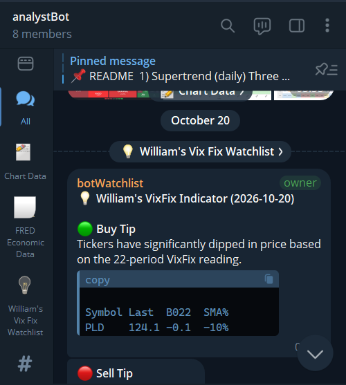
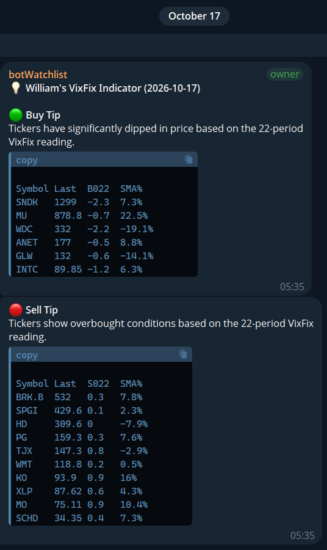
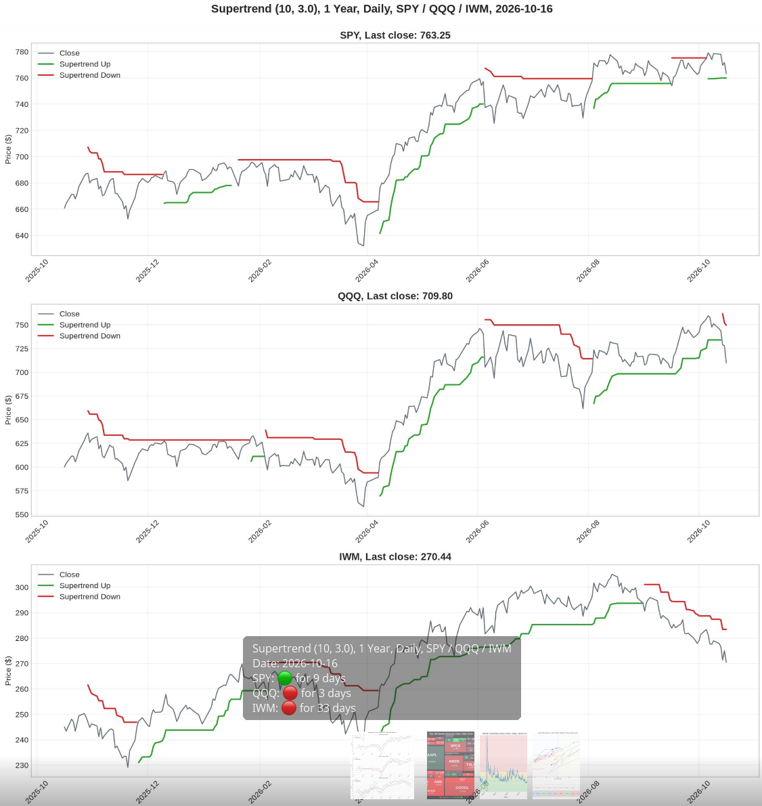
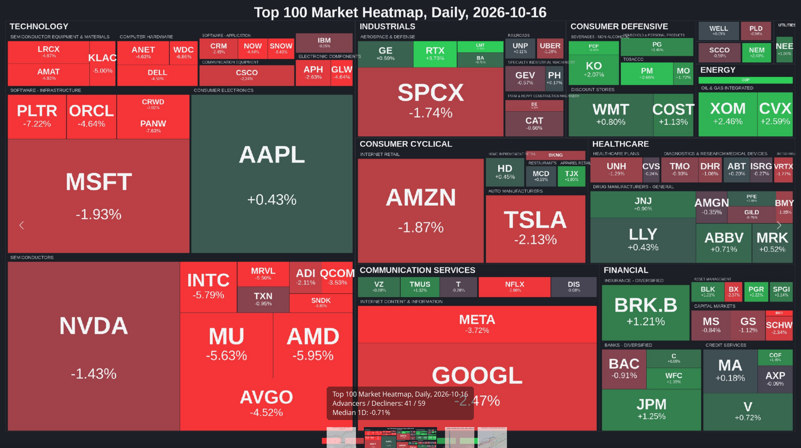
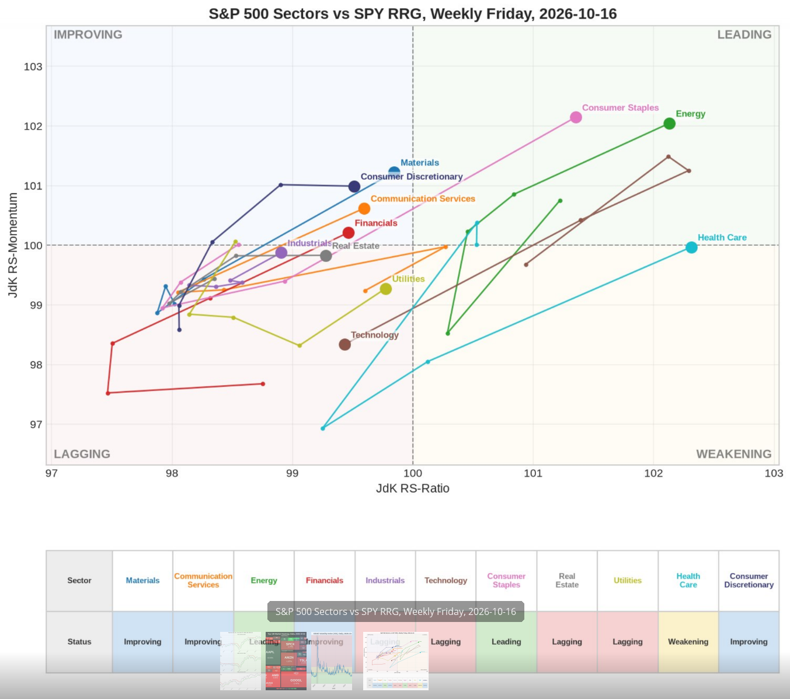
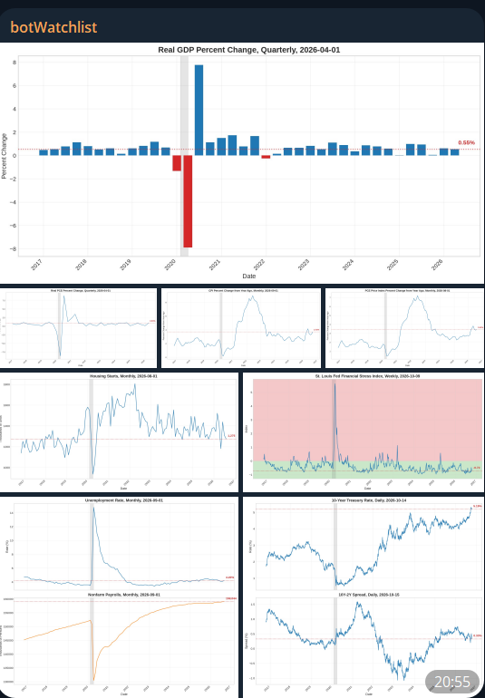
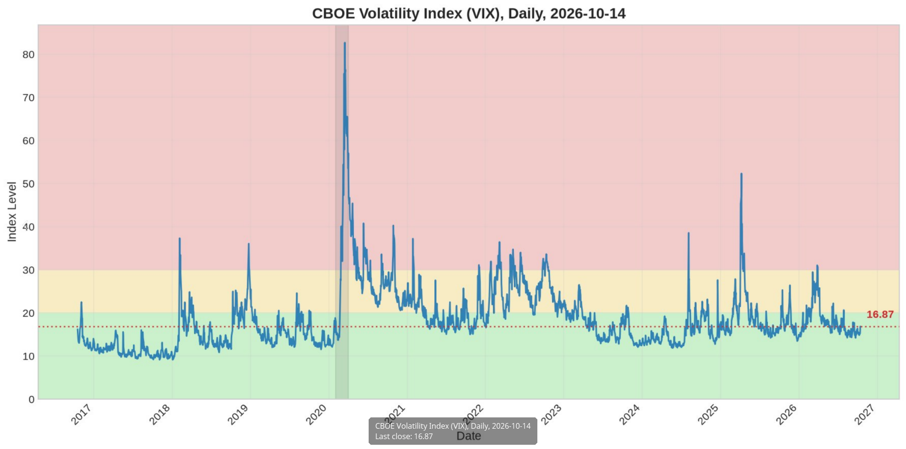

# analystBot

A Python bot that collects daily market and economic data, calculates technical indicators, renders charts, and delivers them to a Telegram group.



## Features

- **[Williams VixFix](https://github.com/joveteo/trading-view-scripts/blob/main/Larry%20Williams%20VixFix/README.md) signals**: daily buy and sell watchlists for a universe of major ETFs and the top 100 U.S. companies by market cap
- **[Supertrend](https://github.com/joveteo/trading-view-scripts/blob/main/custom/Custom%20Supertrend/README.md) chart**: SPY, QQQ, and IWM on one image
- **Market heatmap**: top 100 companies grouped by GICS sector and industry, sized by market cap and coloured by 1-day change
- **Sector rotation (RRG)**: weekly Relative Rotation Graph of the 11 SPDR sector ETFs against SPY
- **Economic charts from FRED**: GDP, consumer spending, CPI and PCE inflation, payrolls, unemployment, housing starts, Treasury yields, financial stress, and VIX, with recession shading
- **Telegram delivery**: messages and albums routed to separate forum topics, sent only when new data is available

| VixFix watchlist | Supertrend |
| --- | --- |
|  |  |

| Market heatmap | Sector RRG |
| --- | --- |
|  |  |

| Economic charts | VIX |
| --- | --- |
|  |  |

## Requirements

- Python 3.12 or newer
- A [tastytrade](https://tastytrade.com) account with an OAuth application for market data, or see [Alternative data source](#alternative-data-source)
- A Telegram bot from [@BotFather](https://t.me/BotFather) and a group with topics enabled
- A [FRED API key](https://fred.stlouisfed.org/docs/api/api_key.html) (optional, for economic charts)

TradingView versions of the indicators are in [trading-view-scripts](https://github.com/joveteo/trading-view-scripts).

## Installation

```bash
git clone https://github.com/joveteo/analystBot-public.git
cd analystBot-public
python3 -m venv venv
source venv/bin/activate
pip install -c constraints.txt .
cp .env.example .env
```

## Configuration

Fill in `.env`:

| Variable | Required | Description |
| --- | --- | --- |
| `TASTYTRADE_CLIENT_SECRET` | Yes | tastytrade OAuth client secret |
| `TASTYTRADE_REFRESH_TOKEN` | Yes | tastytrade OAuth refresh token |
| `TASTYTRADE_CLIENT_ID` | No | tastytrade OAuth client ID |
| `TASTYTRADE_ENV` | No | `production` (default) or `sandbox` |
| `TASTYTRADE_USER_AGENT` | No | User-Agent in `product/version` form; defaults to `analystbot/5.3` |
| `TELEGRAM_BOT_TOKEN` | Yes | Telegram bot token |
| `TELEGRAM_CHAT_ID` | Yes | Telegram group chat ID |
| `TELEGRAM_CHAT_VIXFIX_ID` | Yes | Topic ID for VixFix watchlists |
| `TELEGRAM_CHAT_CHART_ID` | No | Topic ID for Supertrend, heatmap, RRG, and VIX charts |
| `TELEGRAM_CHAT_FRED_ID` | No | Topic ID for economic charts |
| `FRED_API_KEY` | No | FRED API key; economic stages are skipped without it |
| `RRG_RUN_TIMEZONE` | No | IANA timezone for the weekly RRG schedule (default `UTC`) |

**tastytrade OAuth**

1. In tastytrade, go to **Manage → My Profile → API → OAuth Applications** and create a client with the `read` scope.
2. Save the client secret.
3. Create a grant with the `read` scope and save the refresh token.

Production and sandbox credentials are not interchangeable.

**Telegram**

1. Create a bot with @BotFather and add it to a group with topics enabled.
2. Create a topic for each message type.
3. Use the group ID for `TELEGRAM_CHAT_ID` and each topic's thread ID for the `TELEGRAM_CHAT_*_ID` variables.

### Alternative data source

If you do not have a tastytrade account, [Massive](https://massive.com) (formerly Polygon.io) provides daily OHLC aggregates and company market caps through a REST API, with a free tier for end-of-day data. Massive is not built in; to use it, replace the client in `src/analystbot/api/tastytrade.py` with one that calls Massive's aggregates and ticker details endpoints and returns the same bar format.

## Usage

```bash
python -m analystbot
```

Runtime data is stored in `data/` and logs in `logs/`.

### Options

| Command | Description |
| --- | --- |
| `python -m analystbot` | Run the full pipeline |
| `python -m analystbot --rebuild` | Rebuild the database from scratch without sending messages |
| `python -m analystbot --rebuild --symbols AAPL,MSFT` | Rebuild only the given symbols |
| `--supertrend`, `--heatmap`, `--rrg`, `--vix` | Generate and send a market chart immediately |
| `--gdp`, `--real-pce`, `--cpi`, `--pce`, `--nonfarm`, `--unemployment`, `--housing`, `--treasury-10y`, `--yield-spread`, `--stress` | Generate and send an economic chart immediately |

Chart flags can be combined, for example `python -m analystbot --vix --rrg`.

### Scheduling

Run once per trading day after the U.S. market close, for example with cron:

```cron
30 22 * * 1-5 cd /path/to/analystBot-public && venv/bin/python -m analystbot
```

## Development

```bash
pip install -c constraints.txt -e ".[dev]"
ruff check src tests
mypy -p analystbot
python -m unittest discover -s tests
```

## Disclaimer

This project is for informational and educational purposes only and is not financial advice.

## License

[MIT](LICENSE)
